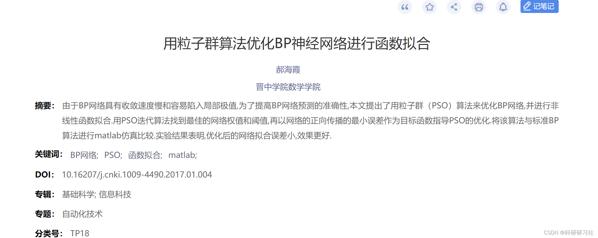
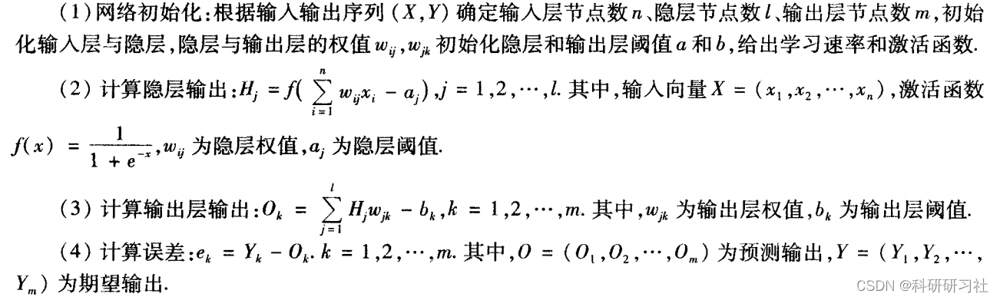
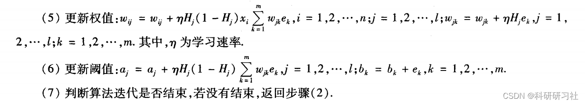
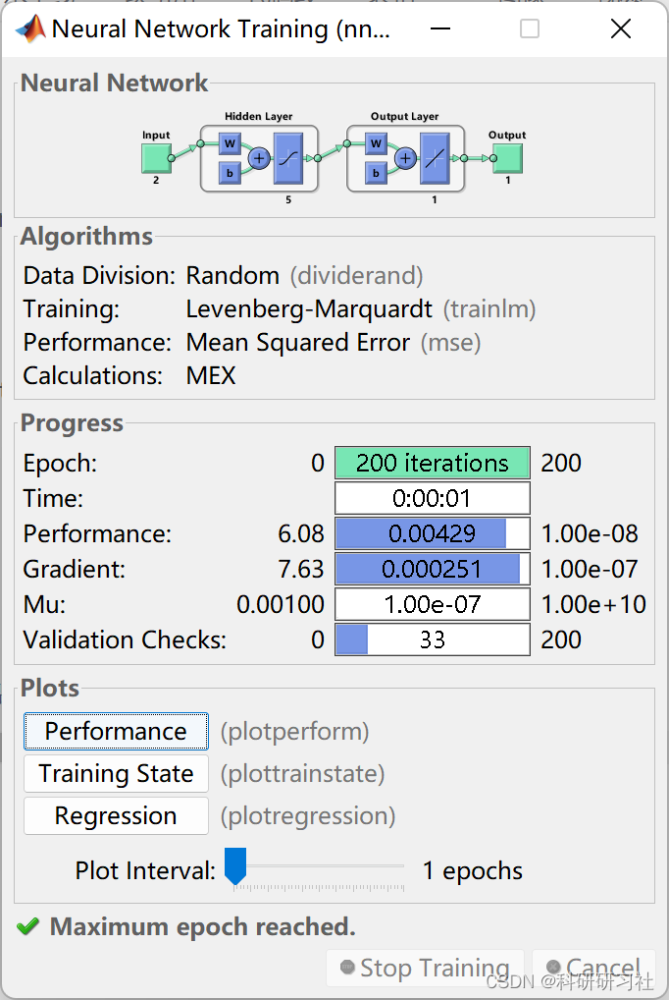
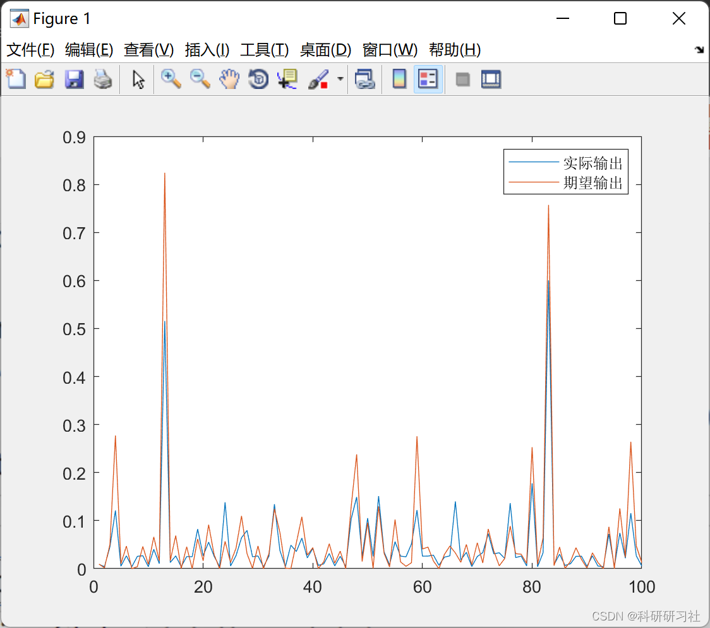
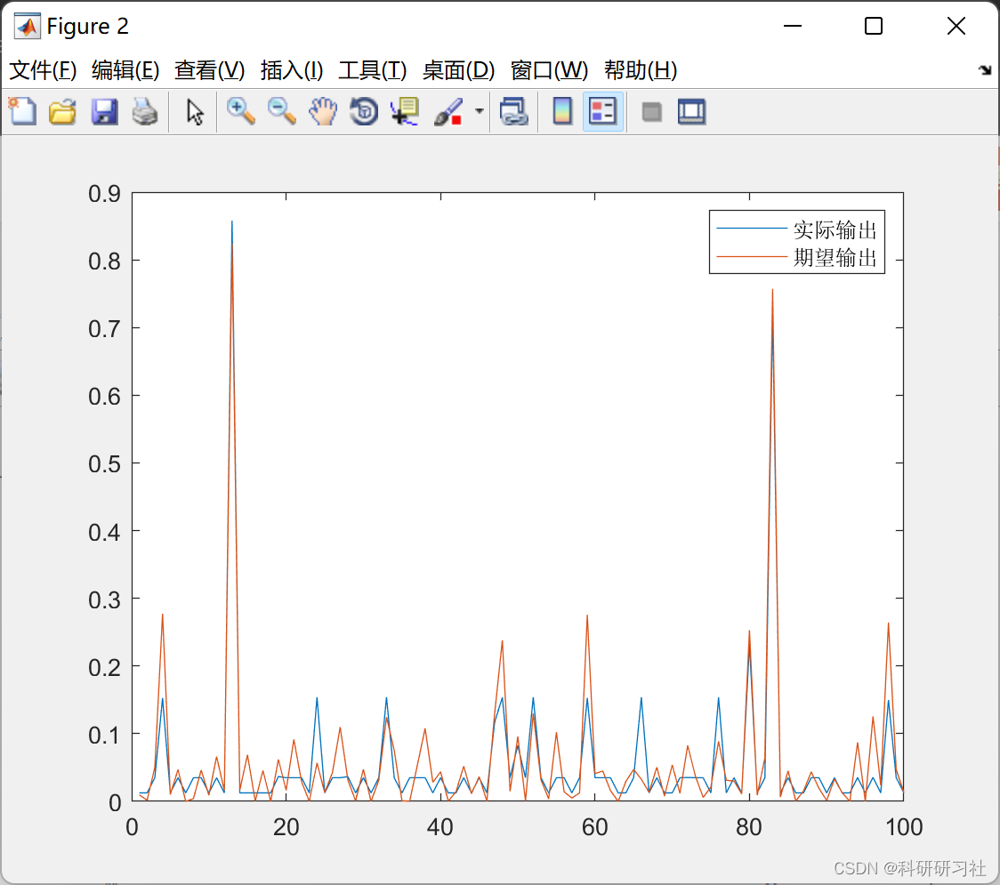
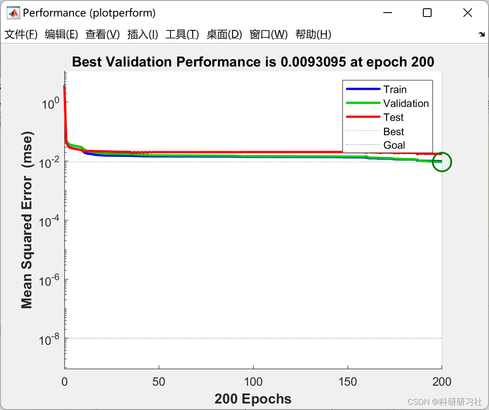
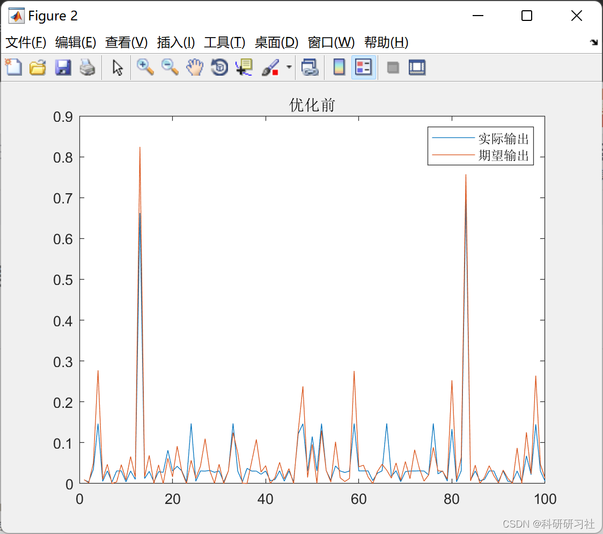
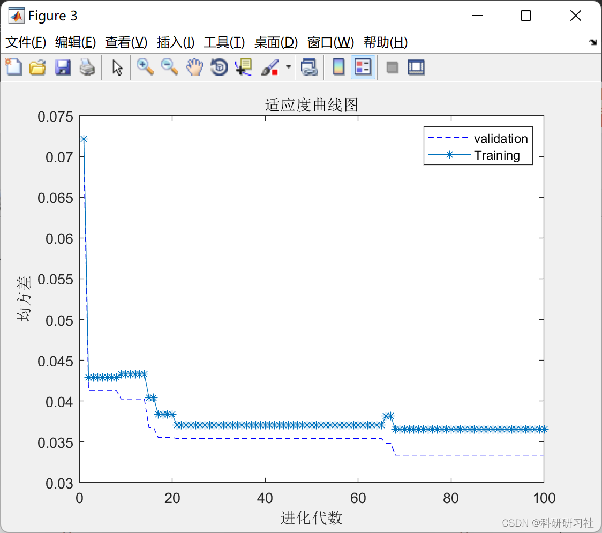
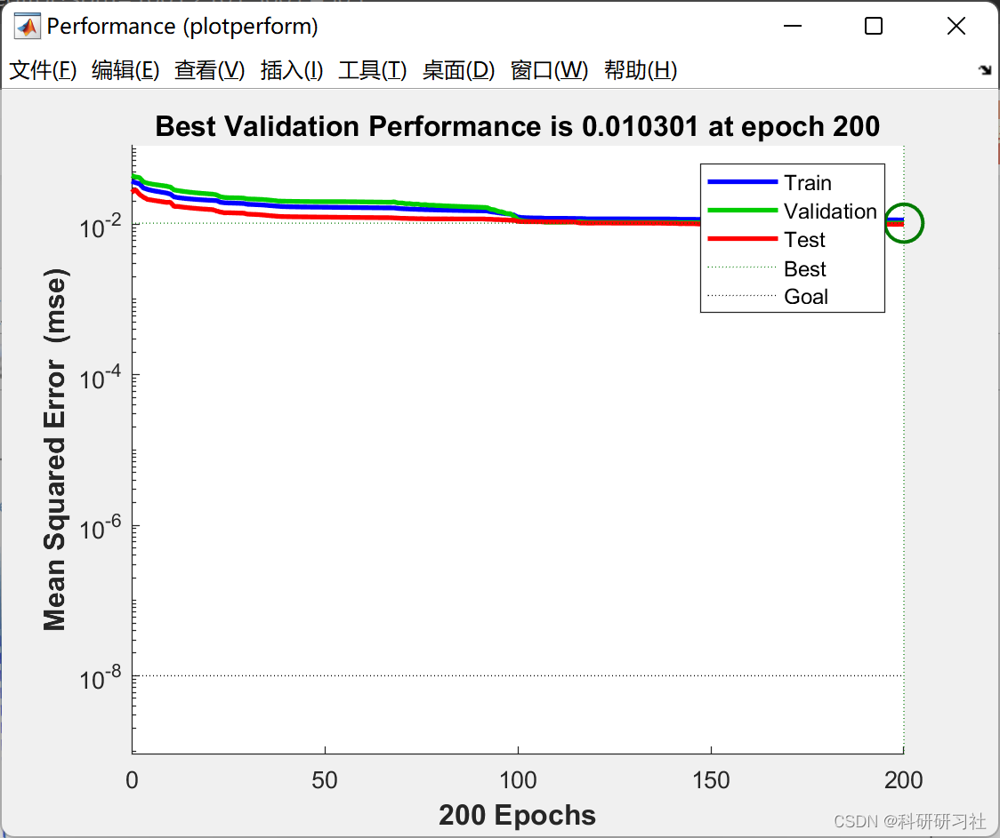

# BP Neural Network Prediction Model Based on Particle Swarm Optimization Algorithm (Matlab Code Implementation)

Editor
Table of Contents
1 Overview
2 Particle Swarm Optimization Algorithm
3 Backpropagation Neural Network
4 PSO-Optimized Backpropagation Network Algorithm
5 Matlab Code and Article
6 Running Results
7 References
8 Closing
1. Overview
In engineering applications, it is common to encounter complex nonlinear systems whose state equations are intricate and difficult to accurately model using mathematical methods. The Backpropagation (BP) neural network essentially realizes a mapping function from input to output. Mathematical theory proves that a three-layer neural network can approximate any nonlinear continuous function with arbitrary precision, possessing very strong nonlinear mapping capabilities. This makes it particularly suitable for solving problems with complex internal mechanisms. This method treats the unknown system as a black box, first training the BP network with input-output data to enable the network to express the unknown nonlinear function. Then, the trained network is used to predict the system's output. However, traditional BP network algorithms have disadvantages such as slow convergence speed, tendency to fall into local minima, and large errors.Therefore, optimizing this network has become necessary. The Particle Swarm Optimization algorithm, as an intelligent algorithm, is a bio-inspired and random search algorithm. It has fewer parameters and exhibits better optimization capabilities. By integrating it with the BP network, we can optimize the weights and thresholds of the BP network, addressing some of its shortcomings and enhancing its ability to fit functions.
2 Particle Swarm Optimization Algorithm: A population-based optimization algorithm.,It originated from the study of bird hunting behavior.,Birds hunting,The simplest and most effective method for each bird to find food is to search the immediate vicinity of the bird that is currently closest to the food source.. PSOThe algorithm is inspired by the behavioral characteristics of this biological population and solves optimization problems..In the algorithm, each particle represents a potential solution to the problem.,Each particle corresponds to a fitness value determined by the fitness function.,The velocity of particles determines their direction and distance of movement.,Speed is dynamically adjusted based on the experience of its own and other particles' movement.,Thus, achieving optimization in the individual's search space..  
Particle Swarm Optimization (with Constraint Handling) - Python & Matlab implementation
Mixing Fireflies and Particle Swarm Optimization Algorithm (Matlab Complete Code)
3 BP Neural Network: A Multilayer Feedforward Neural Network. The topology includes: input layer, Hidden layer Output layer, Its main characteristic is the signal forward transmission. Error Backpropagation. In the forward propagation, The input signal is processed layer by layer from the input layer to the hidden layer. Until the output layer. The neuron states of each layer only affect the neuron states of the next layer. If the output layer does not obtain the desired output, Then, it moves to backpropagation. Adjust the network weights and thresholds based on prediction error. Thus the network prediction output constantly approaches the expected output. The steps of BP network training are as follows:
Editor
Editor
4. Particle Swarm Optimization (PSO) optimization of BP network algorithm. The BP network has strong nonlinear generalization ability. However, its convergence speed is slow. Vulnerable to local extremum. The error is relatively large. To compensate for this shortcoming of the BP network, Combine PSO algorithm with BP network. Optimize the weights and thresholds of a BP network using PSO algorithm. Improved the network's nonlinear fitting capability. The PSO-BP algorithm is as follows:
(1) Initialize the number of training samples m, test sample numbers n, hidden layer node count hidden_num, particle swarm size particle_num, iteration times epoch, inertia weight w, acceleration factor c, C2.
(2) Obtain the input and ideal output of training samples and test samples based on the objective function, and plot the ideal curve and test sample points. (3) Randomly initialize the positions and velocities of particles, and calculate the fitness values of each particle.  
(4) Update the positions and velocities of each particle according to the above formulas, and record the best position of each particle. (5) Record the global optimal position.  
(6) Calculate the output of the test samples and plot the prediction curve and error curve.  
5 Matlab code and article: This paper only displays the main function code, all codes and articles can be found in:
%% Clear environment variables\ntic\nclc\nclear\nclose all\nformat compact\n%% Import data\nload data1\ninput=In';\noutput=U3;\n%%\n% Randomly generate training set and test set\nrand('seed',0)\n\nk = randperm(size(input,1));\nm=7100;\nP_train=input(k(1:m),:)';\nT_train=output(k(1:m));\n\nP_test=input(k(m+1:end),:)';\nT_test=output(k(m+1:end));\n\n%% Normalization\n% Training set\n[Pn_train,inputps] = mapminmax(P_train,-1,1);\nPn_test = mapminmax('apply',P_test,inputps);\n% Test set\n[Tn_train,outputps] = mapminmax(T_train,-1,1);\nTn_test = mapminmax('apply',T_test,outputps);\n\n%% Number of nodes\ninputnum=size(Pn_train,1);\nhiddennum=5;\noutputnum=1;\n%% No optimized bp\nnet=newff(Pn_train,Tn_train,hiddennum);\nnet.trainParam.epochs=200;\nnet.trainParam.lr=0.1;\nnet.trainParam.goal=0.00000001;\nnet.trainParam.max_fail = 200;\n\n% Network Training\n[net,per2]=train(net,Pn_train,Tn_train);\nan=sim(net,Pn_test);\nerror=an-Tn_test;\n\ntest_simu=mapminmax('reverse',an,outputps);\ndisp('Optimized before')\nE1=norm(error);\nE2=mse(error)\nMAPE=mean(abs(error)./Tn_test);\n\nfigure\nplot(test_simu)\nhold on\nplot(T_test)\nlegend('Actual output','Output:')\n\n%% Particle Swarm Optimization BP\n\n\n% [bestchrom,trace]=psoforbp(inputnum,hiddennum,outputnum,Pn_train,Tn_train);%Particle Swarm Algorithm\n% x=bestchrom;\n% save result x\nload result% Instantly call the trained model\n% Optimized BP network using PSO for value prediction\nw1=x(1:inputnum*hiddennum);\nB1=x(inputnum*hiddennum+1:inputnum*hiddennum+hiddennum);\nw2=x(inputnum*hiddennum+hiddennum+1:inputnum*hiddennum+hiddennum+hiddennum*outputnum);\nB2=x(inputnum*hiddennum+hiddennum+hiddennum*outputnum+1:inputnum*hiddennum+hiddennum+hiddennum*outputnum+outputnum);\n\nnet.iw{1,1}=reshape(w1,hiddennum,inputnum);\nnet.lw{2,1}=reshape(w2,outputnum,hiddennum);\nnet.b{1}=reshape(B1,hiddennum,1);\nnet.b{2}=B2';\n\n%% BP network training\n% Network Evolution Parameters\nnet.trainParam.epochs=200;\nnet.trainParam.lr=0.1;\nnet.trainParam.goal=0.00000001;\nnet.trainParam.max_fail = 200;\n\n% Network training\n[net,per2]=train(net,Pn_train,Tn_train);\n\n%% BP network prediction\n% Data normalization\nan=sim(net,Pn_test);\nerror=an-Tn_test;\n\ntest_simu=mapminmax('reverse',an,outputps);\ndisp('Optimized')\nE1=norm(error);\nE2=mse(error)\nMAPE=mean(abs(error)./Tn_test);\ntoc\n%%\nfigure\nplot(test_simu)\nhold on\nplot(T_test)\nlegend('Actual output','Output:')\n  
6 Running Results Editing
Editing
Editing
Editing
Editing
Editing
Editing
7 References [1] Hao Haixia. Optimizing BP Neural Networks for Function Fitting Using Particle Swarm Algorithm [J]. Shanxi Normal University Journal of Natural Sciences, 2017, 31(01): 14-16. DOI: 10.16207/j.cnki.1009-4490.2017.01.004.

## Images

<!-- PAYMENT_BLOCK -->

## Get this dataset

- Payment link (Stripe): [Buy now](https://buy.stripe.com/3cs8yP7sY87d0vu9AB)
- Payment QR code: 

<!-- /PAYMENT_BLOCK -->
